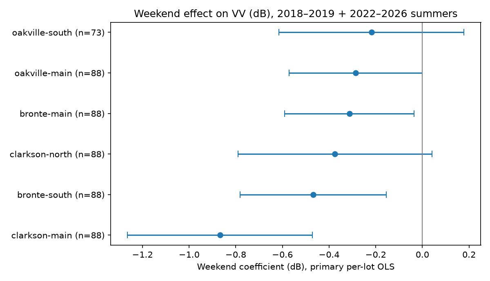

# T1 — Weekend-effect test (pre-registered)

**Hypothesis (H1):** mean VV is lower on weekends/holidays than on weekdays within the same lot (fewer cars at ~19:10). Direction pre-specified: weekend effect < 0.

**Decision: PASS**

## Step 0 — Inspection (no modelling)

Input: `quick-vv-check-2018-2026/vv-by-lot-scene-2018-2026.csv` — 684 rows, 114 scenes, 6 lots, Jun–Aug 2018–2026.

Columns: `lot_id, lot_name, spaces, scene_id, date, datetime_utc, orbit_state, relative_orbit, platform, n_pixels, mean_VV_dB, median_VV_dB, std_VV_dB`. All required columns present: acquisition datetime (`datetime_utc`), lot id (`lot_id`), VV (`mean_VV_dB`, in dB), relative orbit (`relative_orbit`), platform (`platform`).

All acquisition times fall 19:07:42–19:16:59 local (America/Toronto) — within 19:00–19:20 as specified.

Holiday flag: Canada Day (Jul 1; if Sunday, also Jul 2 observed) and Civic Holiday (first Monday of August), treated as weekend. Weekend = Saturday, Sunday, or holiday.

Scenes per year × weekday/weekend (all lots share the same scenes):

|  | weekday | weekend/holiday |
|---|---|---|
| 2018 | 10 | 4 |
| 2019 | 11 | 4 |
| 2020 | 9 | 5 |
| 2021 | 8 | 4 |
| 2022 | 6 | 2 |
| 2023 | 8 | 3 |
| 2024 | 8 | 5 |
| 2025 | 9 | 3 |
| 2026 | 9 | 6 |

Scenes per lot × year × weekday/weekend:

|  | weekday | weekend/holiday |
|---|---|---|
| bronte-main / 2018 | 10 | 4 |
| bronte-main / 2019 | 11 | 4 |
| bronte-main / 2020 | 9 | 5 |
| bronte-main / 2021 | 8 | 4 |
| bronte-main / 2022 | 6 | 2 |
| bronte-main / 2023 | 8 | 3 |
| bronte-main / 2024 | 8 | 5 |
| bronte-main / 2025 | 9 | 3 |
| bronte-main / 2026 | 9 | 6 |
| bronte-south / 2018 | 10 | 4 |
| bronte-south / 2019 | 11 | 4 |
| bronte-south / 2020 | 9 | 5 |
| bronte-south / 2021 | 8 | 4 |
| bronte-south / 2022 | 6 | 2 |
| bronte-south / 2023 | 8 | 3 |
| bronte-south / 2024 | 8 | 5 |
| bronte-south / 2025 | 9 | 3 |
| bronte-south / 2026 | 9 | 6 |
| clarkson-main / 2018 | 10 | 4 |
| clarkson-main / 2019 | 11 | 4 |
| clarkson-main / 2020 | 9 | 5 |
| clarkson-main / 2021 | 8 | 4 |
| clarkson-main / 2022 | 6 | 2 |
| clarkson-main / 2023 | 8 | 3 |
| clarkson-main / 2024 | 8 | 5 |
| clarkson-main / 2025 | 9 | 3 |
| clarkson-main / 2026 | 9 | 6 |
| clarkson-north / 2018 | 10 | 4 |
| clarkson-north / 2019 | 11 | 4 |
| clarkson-north / 2020 | 9 | 5 |
| clarkson-north / 2021 | 8 | 4 |
| clarkson-north / 2022 | 6 | 2 |
| clarkson-north / 2023 | 8 | 3 |
| clarkson-north / 2024 | 8 | 5 |
| clarkson-north / 2025 | 9 | 3 |
| clarkson-north / 2026 | 9 | 6 |
| oakville-main / 2018 | 10 | 4 |
| oakville-main / 2019 | 11 | 4 |
| oakville-main / 2020 | 9 | 5 |
| oakville-main / 2021 | 8 | 4 |
| oakville-main / 2022 | 6 | 2 |
| oakville-main / 2023 | 8 | 3 |
| oakville-main / 2024 | 8 | 5 |
| oakville-main / 2025 | 9 | 3 |
| oakville-main / 2026 | 9 | 6 |
| oakville-south / 2018 | 10 | 4 |
| oakville-south / 2019 | 11 | 4 |
| oakville-south / 2020 | 9 | 5 |
| oakville-south / 2021 | 8 | 4 |
| oakville-south / 2022 | 6 | 2 |
| oakville-south / 2023 | 8 | 3 |
| oakville-south / 2024 | 8 | 5 |
| oakville-south / 2025 | 9 | 3 |
| oakville-south / 2026 | 9 | 6 |

Scenes per relative orbit × year:

|  | 2018 | 2019 | 2020 | 2021 | 2022 | 2023 | 2024 | 2025 | 2026 |
|---|---|---|---|---|---|---|---|---|---|
| 4 | 6 | 8 | 7 | 6 | 4 | 5 | 6 | 5 | 7 |
| 77 | 8 | 7 | 7 | 6 | 4 | 6 | 7 | 7 | 8 |

No VV means are reported in this section, per spec.

## Primary results (years 2018, 2019, 2022–2026; Oakville South 2026 excluded)

Per-lot OLS: `VV_dB ~ weekend + C(relative_orbit) + C(year)` (classical SE). Pooled: `VV_dB ~ weekend + C(lot) + C(lot):C(relative_orbit) + C(lot):C(year)`, SE clustered by acquisition date (CR1, t with G−1 df). Permutation: 10,000 permutations, seed 42, weekend label shuffled among scenes within each (year × relative orbit) stratum, shared across lots within a scene.

| Lot | Weekend coef (dB) | 95% CI | p | n |
|---|---|---|---|---|
| oakville-main | -0.286 | [-0.572, -0.000] | 0.04998 | 88 |
| oakville-south | -0.219 | [-0.616, 0.178] | 0.2755 | 73 |
| clarkson-main | -0.868 | [-1.264, -0.472] | 3.856e-05 | 88 |
| clarkson-north | -0.375 | [-0.790, 0.041] | 0.07663 | 88 |
| bronte-main | -0.313 | [-0.591, -0.035] | 0.02785 | 88 |
| bronte-south | -0.468 | [-0.781, -0.155] | 0.003908 | 88 |

**Pooled:** weekend coef **-0.428 dB**, 95% CI [-0.692, -0.164], clustered two-sided p = 0.001804, n = 513 rows, 87 date clusters. Permutation one-sided p = 0.0012.

## Sensitivity

| Analysis | Pooled coef (dB) | 95% CI | Clustered p | Perm p | n |
|---|---|---|---|---|---|
| S1 — all years 2018–2026 | -0.364 | [-0.578, -0.151] | 0.0009992 | 0.0004 | 669 |
| S2 — Tue–Thu vs Sun+holidays | -0.753 | [-1.006, -0.500] | 2.526e-07 | 0 | 296 |
| S3 — drop Clarkson North | -0.439 | [-0.695, -0.183] | 0.0009833 | 0.0003 | 425 |

S4 — leave-one-lot-out pooled estimates:

| Dropped lot | Pooled coef (dB) | 95% CI | Clustered p | n |
|---|---|---|---|---|
| oakville-main | -0.458 | [-0.719, -0.196] | 0.0007987 | 425 |
| oakville-south | -0.462 | [-0.751, -0.173] | 0.002046 | 440 |
| clarkson-main | -0.337 | [-0.592, -0.081] | 0.01031 | 425 |
| clarkson-north | -0.439 | [-0.695, -0.183] | 0.0009833 | 425 |
| bronte-main | -0.452 | [-0.725, -0.180] | 0.00141 | 425 |
| bronte-south | -0.420 | [-0.689, -0.151] | 0.002579 | 425 |

S5 — **not run**: `polygons/control-areas.geojson` does not exist, so the negative control was skipped as specified.

Full per-model coefficients (including per-lot results for S1–S3) are in `t1_results.csv`.

## Decision against each criterion

1. ✅ Pooled weekend coefficient < 0 with clustered two-sided p < 0.01 — coef -0.428 dB, p = 0.001804.
2. ✅ Permutation one-sided p < 0.01 — p = 0.0012.
3. ✅ ≥ 5 of 6 lots have a negative weekend coefficient — 6/6 negative (Oakville South uses 2018–2025 only).
4. ✅ S5 not run (no control file), so criterion 4 is vacuous — no control area could show an effect.

**Decision: PASS**

## Deviations from the spec

None. Two interpretation notes (not deviations):

- The spec's S2 exception does not define what 'S2 passes' means; it was operationalised as criteria 1–2 applied to the S2 sample (pooled coef < 0, clustered two-sided p < 0.01, permutation one-sided p < 0.01).
- The spec's linear-averaging rule applies 'where averages are needed'; this test performs no cross-scene averaging of VV (the regression uses per-scene `mean_VV_dB` as supplied, and the report shows coefficients only), so the rule does not bite. Per-lot OLS uses classical (homoskedastic) SE, the standard default, as the spec does not specify a robust SE for the per-lot models.

## Reproducibility

- Script: `t1_weekend_test.py` (this file), seed 42, 10,000 permutations. Rerun: `python3 t1_weekend_test.py` from the repo root (uses only numpy, pandas, matplotlib).
- Local working copy is not a git checkout. Remote HEAD of `zhenhuasun/go-transit-parking-sar` at run time: `7025234d93cc14fece51b8a4b31ecba844390097` (verified: that commit touched only `docs/session-prompt.md`). `polygons/` was last modified in commit `eccc1fcb062b05b9659ea91f3f3f34cb1fd996de` (English-only cleanup) and is unchanged since.
- `polygons/`, existing CSVs and existing scripts were not edited; all new outputs are in `calibration/t1/`.

## Plain-language reading

This test asks whether the radar brightness of a parking lot at about 19:10 is systematically lower on weekends and holidays than on weekdays, after accounting for which orbit the satellite was on and which year it was. A lower weekend value would be consistent with fewer cars in the evening, but it is a test of sensitivity to evening car presence, not a measurement of occupancy: without ground-truth calibration, no dB difference can be converted into a number of cars or a percentage full.